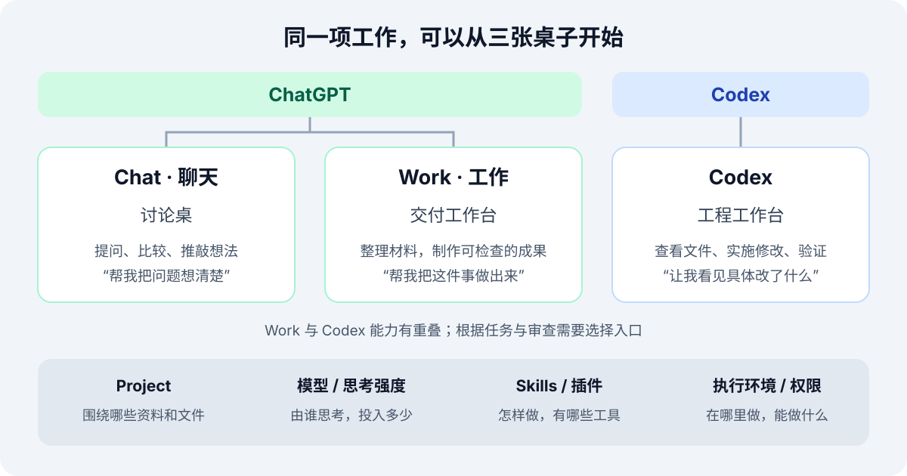

最近打开桌面端，我发现一个看起来很简单、真正用起来却容易混淆的问题：左上角可以选 ChatGPT，也可以选 Codex；选了 ChatGPT，又有“聊天”和“工作”两个入口。

它们都能接收自然语言，都能帮我写东西，有时还都能处理文件。那么，我究竟是在选择模型，还是在选择一种工作方式？Project、插件、Skills 又分别处在哪一层？

我想用一个日常场景把它们串起来：**给自己的 YB 博客写一篇文章，并让它成为博客项目里可以预览的内容。**

> 本文根据 2026 年 10 月 19 日查阅的 OpenAI 官方文档整理，以桌面端为主。具体入口和可用功能会随版本、套餐、地区与工作区设置变化。文中的“工作台”是帮助理解的比喻。

## 一、先看地图：两个产品入口，三种工作方式

当前桌面端的入口，可以先画成这样。官方快速入门也按 Chat、Work 和 Codex 区分使用场景。[官方文档：Quickstart](https://learn.chatgpt.com/docs/quickstart)

我把这三个入口理解成三张桌子：

| 入口                   | 形象理解   | 我坐下来时通常想说什么                             |
| ---------------------- | ---------- | -------------------------------------------------- |
| ChatGPT → Chat（聊天） | 讨论桌     | “陪我把这件事想清楚。”                             |
| ChatGPT → Work（工作） | 交付工作台 | “这些是材料，请帮我做出一个能检查、能使用的成果。” |
| Codex                  | 工程工作台 | “进入这个项目，查看文件、实施修改，再验证结果。”   |

这个比喻强调的是使用重心。Chat 也可以写文章、分析材料；Work 也能运行代码；Codex 同样可以检索资料、写文档。**选择入口时，先想自己要怎样参与这项工作。**

## 二、Chat：一边聊，一边把问题想清楚

假设我只是有个念头：

> 我想写一篇介绍 ChatGPT 和 Codex 的博客，你觉得应该从哪些问题讲起？

这时，我最需要的是讨论：读者是谁，哪些概念最容易混淆，文章应该从界面讲起，还是从实际任务讲起。

Chat 很适合这种来回推敲。它可以解释概念、搜索信息、比较方案，也可以先帮我起草一段文字。它的价值经常体现在：通过几轮对话，我把原本模糊的想法说清楚了。[官方文档：Use ChatGPT](https://learn.chatgpt.com/docs/use-chatgpt)

因此，不能把 Chat 理解成只能闲聊，也不能把 Work 理解成“文章写得更长的聊天”。两者更有用的区别，在于我是否已经准备好把一项有明确终点的任务交出去。

## 三、Work：把目标交出去，拿回可以检查的成果

如果我已经知道自己要什么，需求就会变成：

> 请检索官方文档，写一篇面向普通用户的中文介绍，解释三个入口的区别，附上来源，并交付可以继续修改的文章文件。

这里已经有了材料范围、目标读者、内容要求和交付形式。Work 可以围绕这个目标收集资料、使用工具、制作文件，再根据反馈修改。我仍然需要参与判断，但不用亲自安排每一个中间步骤。

官方把 Work 的典型成果列为报告、演示文稿、分析、工作流和可供检查的文件。桌面端在相应工具可用时，还能使用本地文件、应用和浏览器。[官方文档：Get started with ChatGPT Work](https://learn.chatgpt.com/docs/get-started-with-work)

用做饭打个比方：Chat 更像我和厨师讨论今晚吃什么；Work 则像我交代人数、口味和食材，请厨师准备一桌菜，做好后由我试吃和调整。

## 四、Codex：围绕真实项目，把修改做出来

现在我再把任务向前推进一步：

> 请参考 YB 现有博客的目录和文章格式，把这篇内容写进去，并检查博客能否正常构建。

此时，成果已经和一个真实项目联系在一起。我关心的不只有文字，还包括它放在哪里、是否符合文章格式、图片路径是否正确，以及站点能否生成页面。

这就是 Codex 很自然的使用场景。桌面端为它保留了开发者视图，可以展示文件差异和审查信息，沟通中也更容易涉及实现细节。对需要跟踪“具体改了什么”的任务，这些信息很有用。[官方文档：ChatGPT 桌面端的 Work 与 Codex 对比](https://learn.chatgpt.com/docs/use-chatgpt#compare-chatgpt-work-and-codex-on-desktop)

不过，把 Codex 限定为“只写代码”也太窄了。写博客、整理研究材料、生成文档，都可以在 Codex 中完成。官方明确说明，习惯用 Codex 做非编程工作的人可以继续使用它；Work 提供了适合日常工作的体验。[官方文档：Introducing ChatGPT Work](https://learn.chatgpt.com/docs/get-started-with-work#introducing-work-mode)

**Work 和 Codex 的能力有重叠，工作界面、沟通重心以及可用工具，才是比较时更应该看的部分。**

## 五、Project 到底是什么：一个文件，还是一间工作室？

我最初容易把“选一个 Project”理解成“选一个文件”。更合适的比喻是：**Project 是一间工作室，文件是里面的材料，对话是围绕某个目标展开的一次协作。**

还要区分两类项目：

| 项目类型     | 主要组织什么                         | 应该怎样理解文件访问                     |
| ------------ | ------------------------------------ | ---------------------------------------- |
| ChatGPT 项目 | 相关对话、上传或连接的资料、项目指令 | 项目资料不会自动变成电脑上的某个文件夹   |
| 本地项目     | 电脑上的文件夹及其中的实际文件       | 需要修改本地文件时，把相应文件夹连接进来 |

例如，“AI 工具研究”可以是一个保存资料和相关对话的 ChatGPT 项目；YB 则可以作为一个本地项目，连接博客所在文件夹。

同一个项目可以开展多个对话：一条写新文章，一条调整主题，一条排查构建问题。它们可以面对相同文件，但各自保留对话记录；不要假设另一条对话已经知道这里所有的讨论。

本地项目还可以连接多个相关文件夹，并指定主文件夹。所以，Codex 里的 Project 也不意味着只能有一个文件、一个目录或一条任务。自包含的任务，也可以不先选择项目就开始。[官方文档：Projects and chats](https://learn.chatgpt.com/docs/projects)

## 六、拆开 Codex：六个值得认识的板块

理解了入口和项目以后，其余按钮就容易归位了。下面按用途归纳，具体界面布局可能有所不同。

### 1. 项目与对话：工作在哪里展开

项目聚合相关工作；一条对话承载一个具体目标。例如，YB 是项目，“写 ChatGPT 与 Codex 的介绍”是这次对话的目标。

对于会反复用到的项目约定，还可以用 `AGENTS.md` 保存指导，例如文章目录、写作要求和检查方法。它让后续任务有可以持续参考的说明。[官方文档：Custom instructions with AGENTS.md](https://learn.chatgpt.com/docs/agent-configuration/agents-md)

### 2. 模型与思考强度：由谁思考，投入多少

模型和工作入口是两个维度。进入 Work 或 Codex 后，也可以在可用范围内选择模型和调整思考强度。

模型可以理解成承担任务的“大脑”；思考强度则影响它在复杂问题上投入的推理。更高强度可能改善复杂任务的结果，也通常需要更多时间和用量。它不会因为“想得更久”，就自动获得某个文件夹或服务的访问权。[官方文档：Models](https://learn.chatgpt.com/docs/models)

因此，我会把两道选择分开：先决定需要讨论、交付，还是查看工程细节，再按任务难度选择模型与思考强度。

### 3. Skills 与插件：做事的方法和可用的工具

这两个词经常一起出现，可以这样区分：

| 概念           | 比喻               | 一个博客写作例子                       |
| -------------- | ------------------ | -------------------------------------- |
| Skill          | 操作手册           | 规定查证来源、组织文章、检查输出的流程 |
| Plugin（插件） | 可以安装的工具包   | 带来连接服务的工具，也可能附带 Skills  |
| MCP            | 连接工具的一种协议 | 让代理调用外部服务提供的搜索或读取操作 |

Skill 主要提供任务指导和配套资源；插件可以组合 Skills、MCP 服务等能力。它们并非只能在 Codex 使用，ChatGPT Work 也能使用相关能力。[官方文档：Skills & Plugins](https://learn.chatgpt.com/docs/skills-and-plugins)

比如，同样是“写博客”，Skill 可以告诉它怎样查证与排版；连接资料服务的插件，则可以帮助它取得相应材料。

### 4. 文件与审查：看见具体成果和改动

做完以后，我需要能打开文件，并检查最终结果。桌面端支持在工作区查看文档、表格、图片等输出。[官方文档：ChatGPT desktop app](https://learn.chatgpt.com/docs/app)

在 Git 项目里，Codex 的审查面板还可以展示文件差异：哪些行被增加，哪些行被删除。它支持查看本地修改，也有处理 Pull Request（合并请求）的相关工作流。

这里有个实用细节：审查面板反映的是仓库状态，可能包含我自己或其他工具留下的修改，不能把面板里所有内容都算成这次 Codex 的成果。[官方文档：Code review](https://learn.chatgpt.com/docs/code-review)

### 5. 执行环境与 Worktree：在哪儿动手，怎样分开工作

讨论“能不能用电脑上的文件”时，需要看任务实际运行的环境。

本地执行可以使用获准访问的电脑资源；云端任务则依赖其环境里的文件、工具和连接。Codex Cloud 可以为编码任务准备仓库和开发工具，并让任务在独立工作区里运行。[官方文档：Codex Cloud](https://learn.chatgpt.com/docs/cloud)

如果同一个 Git 项目同时有多个修改任务，Worktree 就像从同一份工程中分出几张工作台，各自拥有一份检出文件。这样可以减少多个任务直接改动同一工作目录的干扰。它依赖 Git，仍然需要在最后检查和整合修改。[官方文档：Worktrees](https://learn.chatgpt.com/docs/environments/git-worktrees)

注意，界面里的 **Work** 是工作模式，**Worktree** 是 Git 的工作目录机制，两个词指向不同的事情。

### 6. 定时任务与权限：何时继续，能做到哪一步

一次任务可以当下执行，也可以安排以后重复，例如定期检查博客引用是否失效。需要本地文件的定时任务，对电脑和应用的运行状态有相应要求。[官方文档：Scheduled tasks](https://learn.chatgpt.com/docs/automations)

而目录访问、命令执行和网络访问等边界，由运行环境、沙箱、审批与工作区策略控制。选择某个项目，或装上某个 Skill，并不等于获得全部操作权限。[官方文档：Agent approvals & security](https://learn.chatgpt.com/docs/agent-approvals-security)

## 七、同样写一篇博客，三个入口会怎样协作？

回到最初的例子，三种方式可以这样安排。这是我的使用建议，不是产品强制的先后顺序。

| 当前阶段      | 可以交代的任务                                   | 我重点检查什么                     |
| ------------- | ------------------------------------------------ | ---------------------------------- |
| 在 Chat 讨论  | “帮我确定读者、文章主线和容易混淆的概念。”       | 观点是否清楚，结构是否适合读者     |
| 在 Work 制作  | “查阅官方资料，形成完整文章，附来源并制作文件。” | 事实、引用、表达和文件质量         |
| 在 Codex 落地 | “参考 YB 的文章格式，把内容放进项目并检查构建。” | 文件位置、修改范围、页面和构建结果 |

这三步也可以由一次 Work 或 Codex 任务覆盖。工具和访问条件合适时，没有必要为了完成一项工作反复切换入口。

我真正需要表达清楚的是终点：“聊出一个提纲”“交付一篇文章”“让博客项目多出一个可预览页面”，是三种不同的验收要求。

拿这次需求来说，“在 YB 下面写一篇博客，可以参考它下面的结构”，就已经包含了本地项目语境：要先看现有内容，再按项目约定落盘，并检查站点能否接受这篇新文章。

## 八、下次打开界面时，我会这样选

如果还在整理想法、比较方案，我会先用 Chat；如果已经有明确成果，希望 AI 把材料和工具组织起来完成任务，我会用 Work；如果要围绕文件、仓库和验证过程检查具体实施，我会用 Codex。

之后再分别确认：项目提供哪些材料，模型和思考强度怎样选，需要什么 Skill 或插件，以及任务实际在哪里执行。

这样再看左上角的选择器，我就知道自己正在决定什么：**这次合作，需要摆出哪一张工作台。**
