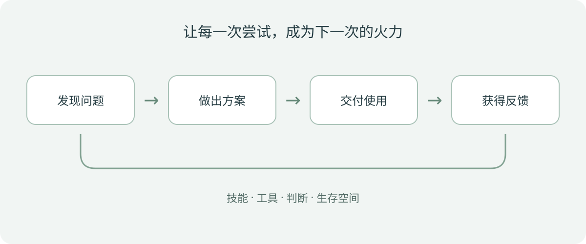

最近，我常常想起一句话：**一切恐惧都源于火力不足。**

这里的“火力”，不是要和谁打一场仗，而是面对变化时，手里有多少可以调动的东西：技能、积蓄、经验、人脉、判断力，还有从头再试一次的勇气。

AI 越来越强，这种火力不足的感觉，也越来越具体了。

以前，一个计算机专业的学生可以沿着一条相对清晰的路线往前走：学语言，做项目，准备面试，进入互联网公司。工作之后，再慢慢积累工程经验。路线不一定容易，但至少能看见路标。

现在，路标还在，可大家已经开始怀疑：等我走到那里，这条路还通吗？

## 一、让人慌张的，不只是 AI 会写代码

Claude、GPT 等工具改变了很多人的工作方式。过去需要自己查资料、搭框架、逐行写代码的任务，现在可以先交给 AI 起草，再由人检查、修改和整合。对一些团队来说，这已经成了日常。

当然，不同公司、岗位和个人的情况差别很大：有人高度依赖 AI，也有人仍然手写大量代码；审查、设计和排错更不会因为有了 AI 就自动消失。只是那个变化的方向，已经足够让人感受到压力。

尤其是刚入行的人，很容易冒出一个问题：**如果 AI 几分钟就能写出我需要练几个月的代码，我还应该学什么？**

在公司工作的人，至少已经拿到了入场券。他们接触过业务，见过真实系统怎么出问题，也可能积累了一些收入和选择的空间。在校学生面对的处境则更加尴尬：工程经验比不过从业者，生成代码的速度比不过 AI，还没有机会证明自己能在真实环境里解决问题。

这并不说明学生没有价值。它说明的是，**把“会写一些代码”等同于“已经准备好创造价值”，越来越不够了。**

## 二、我们害怕的，也许是还没拿到入场券

过去几年，大家追逐的方向不断变化：模型训练、大模型、基础设施、Agent……每一次新机会出现，都有人赶上，也有人站在门外，担心自己慢了一步。

于是问题变成：这场 party 到底才刚开始，还是已经快结束了？

我不知道答案。我也不觉得有人能准确告诉我们，下一波机会会持续多久、哪个岗位一定安全。站在今天回头看，某些方向会很热闹；站在今天往前看，却很难知道热闹能持续到什么时候。

这种不确定性背后，是一个很现实的问题：**以后我靠什么赚钱？**

这不是功利，也不是对理想的背叛。收入意味着生活能继续，意味着可以承担试错的成本，也意味着面对不喜欢的选择时，手里有说“不”的余地。一个人如果还没有建立起这种能力，对未来感到焦虑，是很自然的事情。

但如果把答案只押在“赶上一个热门岗位”，焦虑又很难消失。因为即使这一班车赶上了，我们还是会担心下一次变化。

## 三、火力不是某一项技术，而是一组选择

过去，会前后端、能写 CRUD，了解一些分布式和微服务，就有机会找到一份不错的工作。今天这些基础并没有变得毫无用处，但只拥有这些知识，已经未必足以回答“为什么别人需要我”。

另一头也有个陷阱：因为 AI 很强，就以为基础不再重要。AI 可以帮我们快速生成代码，却不能替我们承担所有后果。它可能误解需求，改动不该改的地方，或者给出看似合理、实际上无法运行的方案。要发现这些问题，仍然需要理解代码、系统和业务。

所以我更愿意把火力看成几种能力的组合：

- **基本功**：理解代码、数据和系统，知道怎样检查结果、定位问题。
- **使用工具的能力**：能让 AI 帮自己探索、实现和验证，而不是只看它给出的漂亮答案。
- **发现问题的能力**：知道谁遇到了什么麻烦，为什么现有办法不够好。
- **交付能力**：把一个想法做成别人能用的东西，并且持续修正。
- **生存空间**：时间、积蓄、可靠的关系和身体状态，让自己有余地尝试下一次。

它们不需要一次性全部具备。重要的是，每做一件事，能不能让其中某几项比昨天更扎实一点。

## 四、不要等学完所有东西，再去碰真实世界

如果今天还是按部就班地列一张长长的学习清单：Java、Java Web、Spring Boot、Spring Cloud、各种消息队列……每一项都要彻底掌握之后才敢开始做事，那可能永远也等不到准备好的那一天。

这不是说这些技术不值得学，而是可以换一种顺序：**先找到一个具体的问题，再围绕它学习。**

比如，你发现同学整理求职信息很费劲，那就试着做一个简单的信息汇总工具；如果社团需要管理活动报名，就做一个能跑起来的报名页面；如果某个小商家反复处理相似的表格和文案，也可以先了解他们的流程，看看哪里能省下一点时间。

过程中你自然会遇到数据库、接口、部署、权限和错误处理。遇到了就学，AI 可以做陪练、提供思路，也可以帮助你快速搭出原型。但最终要由你确认：它是否真的能用，有没有解决最初的问题。

这样的练习未必立刻带来收入，却能让你接近一个更重要的问题：**有人愿意为什么样的结果付钱？**

## 五、赚钱，是一场需要反馈的探索

我认为，消解焦虑的一条现实路径，是尝试去赚钱。不是要求每个人立刻创业，更不是说收入是衡量人的唯一标准，而是希望我们能通过真实的交换，理解自己创造了什么价值。

这条路可以从很小的地方开始：

1. **找一个具体的人和问题。** 和同学、老师、商家或内容创作者聊聊，了解他们反复花时间处理什么。
2. **做一个最小的尝试。** 用自己现有的技能和 AI 工具，做出一个可以展示的版本；先控制投入的时间和成本。
3. **拿到真实反馈。** 看对方是否愿意使用、推荐或付费，也听听他们为什么拒绝。免费试用和一句“不错”，与真正愿意支付之间仍有距离。
4. **复盘后再决定。** 有需求就继续改进；没有需求就换一个问题。保留下来的经验、作品和关系，同样是积累。

赚到第一笔钱，金额可能很小，却能带来一种很具体的信心：原来我可以找到问题、做出东西，并让它对别人有用。

同时，不要把一次尝试的失败理解为自己不行。市场、时机、渠道、信任和成本都会影响结果。更不要因为着急赚钱，就忽略学业、生活和自己能够承受的风险。可以在完成眼前责任的同时，给探索留一块可控的时间。

## 六、这条路可能孤独，但不必一个人走

探索没有标准答案，最难的时候，往往不是技术问题，而是不知道自己做的事情有没有意义。

身边的人可能在准备考试、投简历、追热点，你却在反复修改一个不知道有没有人用的小工具。你会怀疑是不是选错了方向，也会羡慕那些看起来已经上车的人。

这种孤独是真实的。但探索不必完全关起门来。找愿意一起做项目的朋友，把过程写下来，向真实用户请教，加入一个认真讨论问题的社群，或者找老师和有经验的人聊聊。别人不能替你走路，却可能帮你看见自己忽略的岔路。

也不必把进入公司和独立探索当成互斥的选择。实习、求职、做项目、尝试小生意，都可以是认识世界的方式。每个人拥有的时间、资源和责任不同，走法当然也不同。

## 七、先给自己攒一点火力

我们不知道这场 AI 的 party 什么时候结束，也不知道下一个机会会在哪里。对于还没有入场券的人，这种不确定尤其刺眼。

但我们可以从眼前做起：学一点能用的基础，熟悉手边的工具，找到一个真实问题，做出一个小东西，再听听使用它的人怎么说。如果能赚到钱，当然很好；如果暂时没有，也尽量让每次尝试留下经验和作品。

火力不是某一天突然拥有的，它是在一次次学习、交付、碰壁和调整中攒起来的。等手里可调动的东西多一点，恐惧也许不会完全消失，但我们会更有底气，继续走进迷雾。
