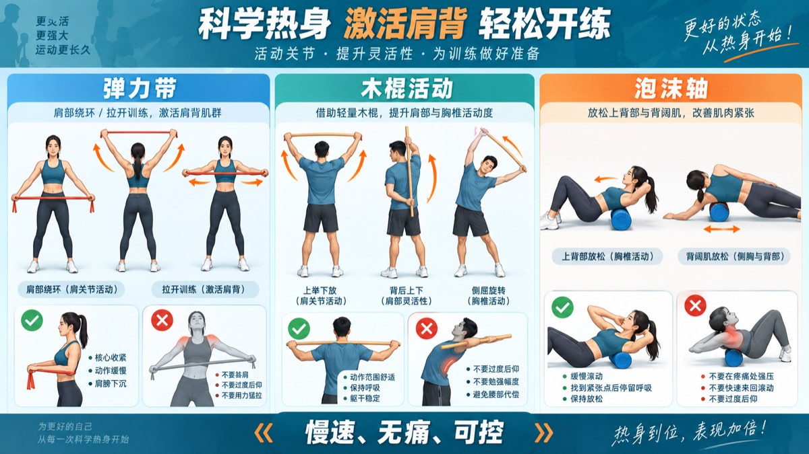
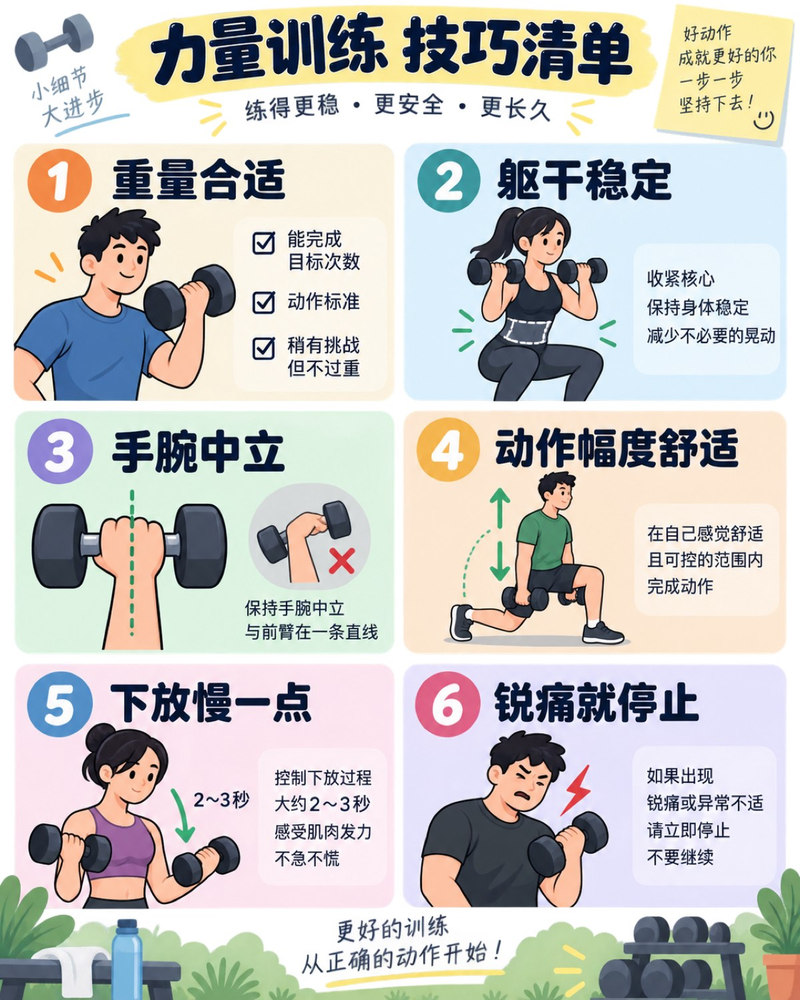
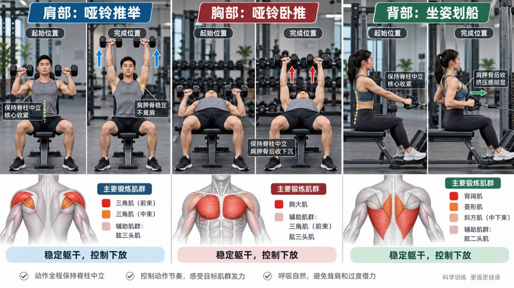
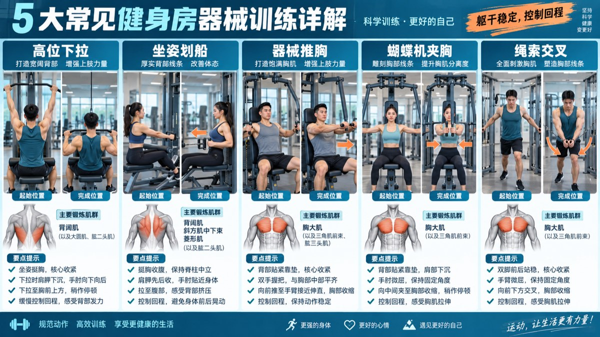

# 从热身到力量训练：弹力带、木棍、泡沫轴与肩胸背训练指南

力量训练不只是“把重量举起来”。真正高质量的训练，应该包含三个环节：先让身体进入状态，再用稳定、可控的动作刺激目标肌群，最后根据恢复情况逐步增加训练量。

本文以肩部、胸部和背部为重点，介绍弹力带、木棍、泡沫轴热身，以及常见器械和哑铃的使用方法。每个动作都强调四件事：起始姿势、发力方向、动作控制和停止标准。

> 本文适合一般健康成年人进行训练参考。如果你有肩颈、腰背、心血管或关节疾病，或曾经受过伤，请先咨询医生或康复/运动专业人士。

## 一、训练前先理解：热身不是拉到越痛越好

热身的目的不是把身体“拉松到极限”，而是提高体温、让关节逐渐进入活动范围、唤醒目标肌群，并通过低负荷动作检查当天的身体状态。

好的热身通常具备三个特点：

- 动作幅度逐渐增加，而不是一开始就做到最大；
- 全程无明显疼痛，尤其没有尖锐痛、麻木或卡住感；
- 结束后感觉身体更灵活、更稳定，而不是疲惫或酸痛。

## 二、弹力带热身：激活肩胛与肩袖

### 1. 弹力带拉开（Band Pull-Apart）

**做法：**

双手在胸前握住弹力带，手掌向下或相对，肘部保持自然伸直。慢慢向两侧拉开，直到肩胛骨向后靠拢，再缓慢回到起始位置。

**关键点：**

- 胸廓不要明显挺起或塌腰；
- 肩膀远离耳朵，不要耸肩；
- 想象“手臂向外延长”，而不是单纯用手腕拉带；
- 拉开和回程都要控制，回程不要让弹力带突然弹回。

建议做 1–2 组，每组 10–15 次。热身时选择较轻阻力，以感觉肩胛周围发热为目标。

### 2. 弹力带肩关节绕环

双手宽握弹力带，从身体前方慢慢举过头顶，再绕到身后，然后按相反方向返回。握距应足够宽，让动作在无痛范围内完成。

**不要追求：**双手必须贴着身体绕一圈。若出现肩前方疼痛、夹挤感或动作卡顿，应增加握距或换成更小幅度的活动。

### 3. 弹力带外旋

将弹力带固定在身侧，肘部夹在身体旁，前臂从腹部向外旋转。这个动作适合低阻力激活肩袖。

**控制要求：**肘部不要离开身体，手腕保持中立，身体不要为了完成动作而旋转。

## 三、木棍热身：活动肩部与胸椎

木棍可以用轻量体操棒、PVC 管或干净的长棍代替。它的作用是帮助双手保持同一轨迹，并提供轻微的活动辅助。

### 1. 木棍上举

双手宽握木棍，慢慢从胸前举过头顶，再回到胸前。全程保持肋骨不要外翻，腰部不要过度后仰。

**关键点：**如果手臂举到某个角度时出现疼痛，不要用木棍强压过去；可以缩小握距以外的方向，或只做到无痛范围。

### 2. 木棍肩胛活动

双手在胸前握住木棍，缓慢做水平外推和回收，感受肩胛骨在胸廓上的滑动。重点是肩胛活动，而不是耸肩或夹背到极限。

### 3. 胸椎旋转与侧屈

将木棍轻放在肩后或胸前，保持骨盆相对稳定，缓慢向左右旋转；也可以做小幅度侧屈。

**注意：**动作来自胸椎，不要靠腰部猛拧。腰椎出现不适时应立即减小幅度或停止。

## 四、泡沫轴：放松与活动，不是越痛越有效

泡沫轴适合做短时间、低强度的自我放松。常用区域包括上背部、背阔肌外侧、胸椎周围和臀部。

### 1. 上背部滚动

仰卧，将泡沫轴放在上背部，双手抱头或交叉于胸前，缓慢滚动。找到紧张区域后，可以停留 15–30 秒，并配合平稳呼吸。

### 2. 背阔肌区域

身体侧卧，把泡沫轴放在腋窝下方到上臂外侧附近，缓慢滚动。不要直接压迫腋窝深处，也不要在麻木、刺痛区域持续施压。

### 3. 泡沫轴胸椎伸展

泡沫轴横放在上背部，双手托住头部，轻轻让胸椎向后伸展。幅度小、呼吸自然即可，不要塌腰代偿。

**判断标准：**泡沫轴带来的感觉应该是可承受的酸胀或压力，而不是锐痛、麻电感、头晕或恶心。

## 五、训练动作的通用控制原则

无论使用哑铃、拉力器还是固定器械，都可以用下面的标准检查动作：

1. **重量合适：**能在保持动作标准的前提下完成目标次数，最后 2–3 次有挑战但不需要借力乱甩。
2. **躯干稳定：**腹部轻度收紧，避免塌腰、过度挺胸或身体摆动。
3. **关节对齐：**手腕、肘、肩尽量处于自然排列，不为了追求幅度而扭转关节。
4. **下放可控：**负重回到起始位置时不要自由落体，通常用约 2–3 秒完成下放。
5. **呼吸自然：**发力阶段呼气，回程阶段吸气；不要长时间憋气硬顶。
6. **疼痛分级：**肌肉发力和轻微酸胀可以接受；尖锐痛、关节深处痛、麻木、放射痛和明显卡顿不应硬撑。

## 六、肩部训练：重视肩胛稳定与肩袖参与

肩部训练主要包括前三角、中三角、后三角，同时需要肩袖和肩胛周围肌群协同。肩关节活动范围很大，因此更需要控制，而不是盲目追求重量。

### 动作 1：哑铃肩推

**目标：**三角肌前束和中束，肱三头肌辅助。

**做法：**

坐姿或站姿，哑铃位于肩膀两侧，前臂大致垂直地面。保持躯干稳定，将哑铃向上推至手臂接近伸直，再缓慢下放。

**关键点：**

- 手腕保持中立，不要向后折；
- 肘部不要强行向外张到完全一条直线；
- 下放到肩部舒适位置即可；
- 不要靠腰部后仰完成最后几次。

### 动作 2：哑铃侧平举

**目标：**三角肌中束。

手持轻哑铃，肘部微屈，沿身体两侧抬起至接近肩高，再缓慢下放。

**关键点：**

- 想象肘部向两侧移动，手腕不要高过肘部；
- 不需要抬到超过肩高；
- 不要耸肩、甩动或借助惯性；
- 这个动作通常需要较轻重量。

### 动作 3：俯身反向飞鸟

俯身或坐姿俯身，哑铃从身体下方向两侧打开，重点感受后三角和肩胛周围发力。背部保持稳定，不要通过大幅摆动躯干来完成动作。

## 七、胸部训练：先稳定肩胛，再推动重量

胸部训练常见动作包括卧推、器械推胸和夹胸。胸大肌负责把手臂向前、向内推，肩前侧和肱三头肌会参与辅助。

### 动作 1：哑铃卧推

**做法：**

仰卧在平凳上，哑铃位于胸部两侧，肩胛骨向后下方稳定，脚掌踩地。将哑铃向上推，再缓慢下放至胸部舒适位置。

**关键点：**

- 前臂在底部大致垂直于地面；
- 手腕不要向后折；
- 肘部不要完全向外打开，通常与躯干保持自然夹角；
- 下放时保持肩胛稳定，不要让肩膀向前滚；
- 两只哑铃下降高度尽量一致。

### 动作 2：器械推胸

调整座椅高度，使把手大约位于胸部中段。推起时保持背部贴靠靠垫，回程时控制把手返回，不要让重量片猛烈碰撞。

**常见错误：**座椅过低导致肩膀耸起；推到最后时锁死肘关节；回程幅度过大导致肩前方不适。

### 动作 3：绳索夹胸

站在拉力器中间，双手从身体两侧向前、向内合拢。胸部保持打开，肘部微屈且角度基本固定。

**关键点：**这是夹胸，不是弯举；不要在动作过程中反复弯曲手肘。回程时同样要慢，感受胸肌在拉长位置的控制。

## 八、背部训练：先学会“拉肘”，不要只用手拉

背部训练常见目标包括背阔肌、菱形肌、斜方肌和竖脊肌。很多人练背时前臂先疲劳，原因是过度握紧、只想着把手柄拉向身体，而没有让肘部带动动作。

### 动作 1：坐姿划船

**做法：**

坐稳，脊柱保持中立，双手握住手柄。先让肩胛骨自然向前，再通过肘部向后拉，将手柄带向腹部或下胸部，停顿后缓慢还原。

**关键点：**

- 拉回时不要过度后仰；
- 肘部向后、略向身体两侧移动；
- 回程时让肩胛骨受控前伸，不要突然放松；
- 保持颈部放松，不要探头。

### 动作 2：高位下拉

握距略宽于肩，胸廓保持自然，先下沉肩胛，再将肘部向下拉。横杆拉到上胸附近即可，不建议为了追求幅度强行拉到颈后。

**重点：**不要用身体大幅后仰借力，也不要把动作变成快速甩动。

### 动作 3：单臂哑铃划船

一手一膝支撑在凳上，另一手持哑铃。保持背部平稳，让肘部向髋部方向拉，顶端停顿后慢慢放下。

**控制要点：**不要耸肩，不要旋转躯干，不要把哑铃只拉向胸口。肘部朝向髋部通常更容易找到背阔肌的参与。

### 动作 4：哑铃罗马椅/俯身飞鸟类动作

如果选择俯身动作训练后束和上背，重量应很轻，重点是肩胛和上背的控制。若腰部容易疲劳，优先选择胸部支撑的器械或卧姿变式。

### 常见固定器械补充图

下面这张图补充展示了高位下拉、坐姿划船、器械推胸、蝴蝶机夹胸和绳索交叉。实际使用时，先调整座椅、靠垫和配重，再从轻重量开始熟悉轨迹。

器械训练的共同原则是：身体尽量贴合靠垫或保持稳定，关节不要被重量“拽”到末端，回程阶段慢慢放回。每台器械的座椅高度和握把位置不同，优先以器械上的说明和现场教练指导为准。

## 九、推荐的基础训练安排

如果每周训练 2–3 次，可以采用全身训练，每次从肩、胸、背中各选择 1–2 个动作：

| 部位 | 动作示例 | 组数 × 次数 |
| --- | --- | --- |
| 肩部 | 哑铃肩推、侧平举 | 2–3 组 × 8–15 次 |
| 胸部 | 哑铃卧推、器械推胸 | 2–4 组 × 6–12 次 |
| 背部 | 坐姿划船、高位下拉 | 2–4 组 × 8–12 次 |

组间休息通常为 60–120 秒。新手应优先练习动作路径和控制，不必一开始就追求大重量。连续几次训练都能稳定完成目标次数后，再小幅增加重量或次数。

## 十、训练后和第二天怎么判断是否合适？

合适的训练可能带来肌肉疲劳或延迟性酸痛，但不应出现明显关节痛、持续锐痛、麻木、活动范围明显下降或夜间痛。

如果训练后疼痛持续加重，或第二天无法完成日常抬手、推门、穿衣等动作，应暂停相关动作并进行评估。尤其是肩关节出现卡住、无力、明显肿胀或受伤后突然失去力量时，不要继续“练开它”。

## 结语：动作质量决定训练收益

热身的意义是让身体准备好，力量训练的意义是让目标肌群在稳定轨迹中承受足够刺激。弹力带、木棍和泡沫轴可以帮助你进入状态，但不能替代正式训练；哑铃和器械也不是越重越好，真正重要的是重量合适、躯干稳定、下放可控、呼吸自然，以及在疼痛信号出现时及时调整。

> 本文为运动科普，不构成诊断、康复或个体化训练处方。动作存在疑问时，建议请教合格教练或物理治疗师进行现场纠正。
