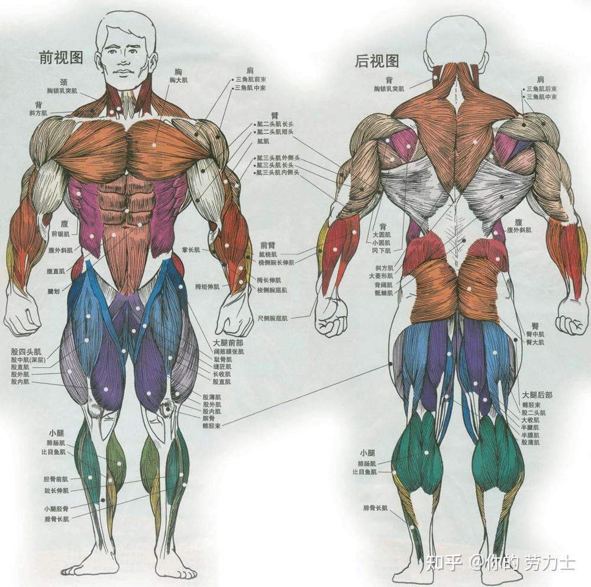
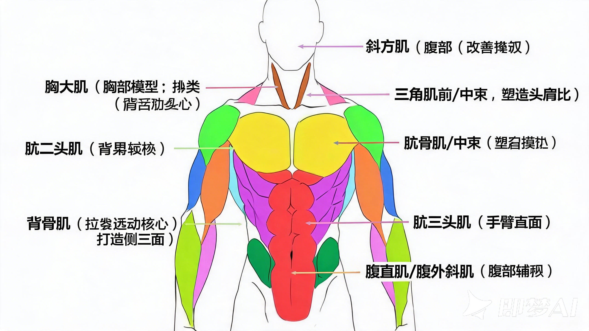

## 人体肌肉分布

对于健身场景，我们这里只讨论人体的上半部，下半部锻炼暂不考虑。

### 颈部（颈）

胸锁乳突肌：在前视图与后视图的颈部两侧均有标注。

### 胸部（胸）

胸大肌：分布于胸部正前方大面积区域。

### 肩部（肩）

- 三角肌前束：分布于前视图肩部前方。
- 三角肌中束：在前视图与后视图的肩部外侧均有标注。
- 三角肌后束：分布于后视图肩部后方。

### 背部（背）

- 斜方肌：跨越上背部及颈后方（前视图可看到上缘，后视图展现完整大面积）。
- 背阔肌：后视图中背中部至腰侧的大面积肌群。
- 大圆肌、小圆肌、冈下肌：位于后视图肩胛骨周围。
- 大菱形肌、骶棘肌：位于后视图背部中轴及腰部深层区域。

### 手臂（臂与前臂）

上臂：

- 肱二头肌（长头、短头）、肱肌：前视图上臂前侧。
- 肱三头肌（外侧头、长头、内侧头）：在后视图与前视图侧边均有标注。

前臂：

- 肱桡肌、桡侧腕长伸肌：前臂外侧/前侧。
- 掌长肌、拇长伸肌、拇短伸肌、桡侧腕屈肌、尺侧腕屈肌：前臂前侧及屈/伸肌群。

### 腹部（腹）

- 前锯肌：前视图胸大肌下方、肋骨两侧。
- 腹外斜肌：前视图与后视图的侧腰位置。
- 腹直肌与腱划：前视图腹部正中央的块状肌群。

以上的分类还是太多了，大家在健身房普遍都在做什么锻炼呢？健身房和日常训练里，大家最常练的**核心三大主干部位**是：**胸部、背部、肩臂**（再加上腹肌作为日常辅助）。这些肌肉位置图如下：

**1. 胸部模块（推的力线核心）**

* **主要目标肌群**：**胸大肌**。
* **肌肉特点**：面积大、反馈快，是打造上腰身厚度和“正面门面”的关键。
* **日常黄金动作**：杠铃/哑铃卧推、俯卧撑、双杠臂屈伸、绳索夹胸。

**2. 背部模块（拉的力线核心）**

* **主要目标肌群**：**背阔肌、斜方肌**（以及大/小圆肌）。
* **肌肉特点**：决定了上半身的宽度（倒三角造型）和挺拔姿态（改善驼背、圆肩）。
* **日常黄金动作**：引体向上、高位下拉、划船类动作（哑铃/杠铃划船）。

**3. 肩部与臂部模块（肩臂联动）**

* **肩部（三角肌）**：
* 重点练**前束**与**中束**（尤其中束，能直接拉宽肩宽，塑造“头肩比”）。
* 黄金动作：哑铃推举（推）、侧平举（练中束）。

* **手臂（肱二头肌 / 肱三头肌）**：
* **肱二头肌**（手臂正面）：弯举类动作（哑铃弯举、拉力器弯举）。
* **肱三头肌**（手臂背面，占手臂2/3体积）：手臂下压、臂屈伸。

**4. 腹部模块（核心辅助）**

* **主要目标肌群**：**腹直肌、腹外斜肌**。
* **日常黄金动作**：卷腹、平板支撑、悬垂举腿。

## 胸部锻炼器械与动作
