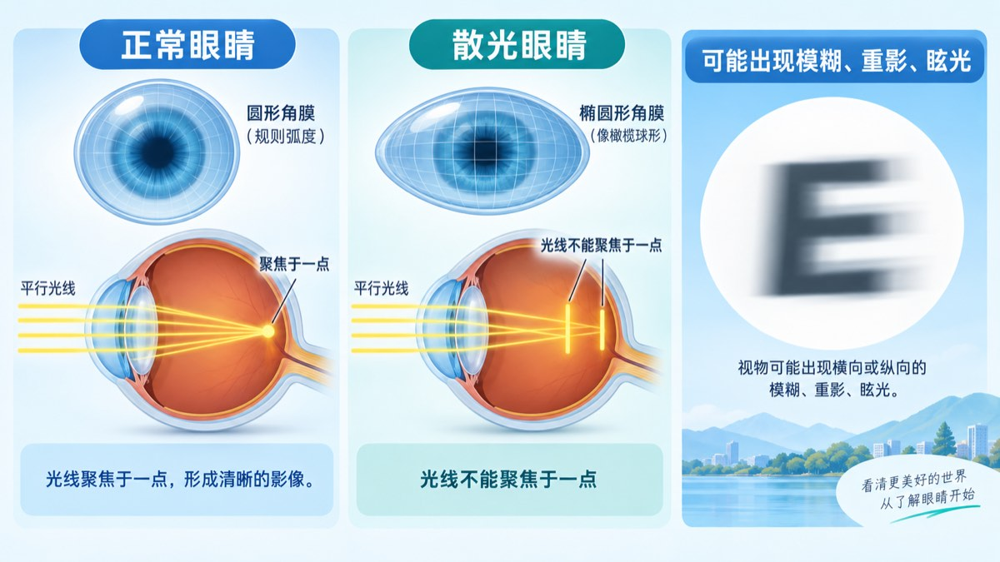
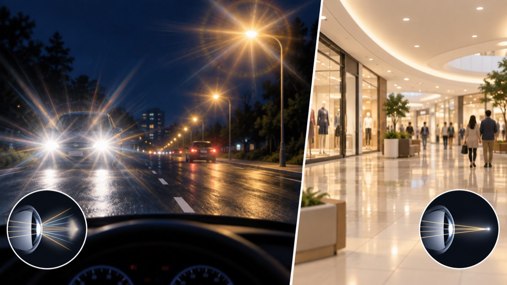
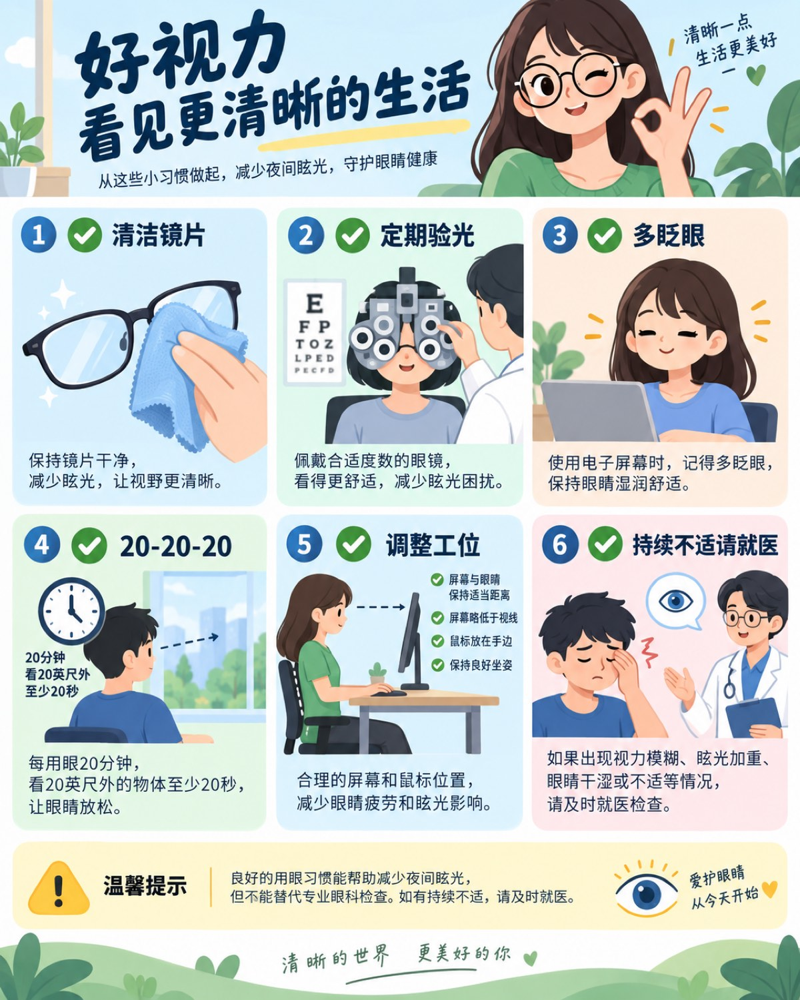

# 为什么车灯刺眼、路灯发散？一篇讲清散光与夜间眩光

> 你可能有过这样的体验：白天看东西还好，商场里的灯也没什么问题，可一到晚上，车灯、路灯却变成“光芒四射”的小太阳。很多人会把它简单归结为“散光没矫正好”，但真实情况往往更复杂。

本文从散光的原理讲起，解释常见场景背后的原因，并给出日常缓解、眼镜护理和就医检查建议。文章用于科普，不能替代眼科面诊。

## 一、散光到底是什么？

理想情况下，角膜和晶状体的曲率比较均匀，进入眼睛的光线会尽量聚焦在视网膜上的一个点，形成清晰影像。

散光时，角膜或晶状体在不同方向上的弯曲程度不完全一样，更像“橄榄球”而不是规则的球面。于是，水平方向和垂直方向的光线不能同时聚焦在同一个点上，而是形成不同位置的焦线。

这会带来几类表现：

- 远近都可能有些模糊或变形；
- 文字、灯光出现横向或纵向拖影；
- 容易眼疲劳、眯眼或头痛；
- 夜间看灯时更容易出现光晕、放射线和眩光。

散光的度数通常用“柱镜度数”和“轴位”描述。柱镜度数表示散光大小，轴位表示散光方向。两者都要合适，眼镜才能较好地矫正散光。[National Eye Institute](https://www.nei.nih.gov/eye-health-information/eye-conditions-and-diseases/astigmatism)

## 二、为什么白天还好，夜间车灯却特别明显？

### 1. 暗处瞳孔会变大

光线变暗时，瞳孔会扩大。更多来自角膜边缘的光线进入眼睛，轻微的残余散光、近视、角膜不规则或镜片误差，都可能被放大。

### 2. 车灯和路灯是“高亮点光源”

车灯、路灯通常是黑暗背景中的小而强的光点。任何一点光学散射，都会被看成光晕、星芒或拖影。

而商场的照明往往更均匀，周围环境也更亮，瞳孔相对较小，因此同样的视觉问题不一定明显。

### 3. 眼镜并不一定能消除所有眩光

即使已经配镜，仍可能存在：

- 散光度数或轴位发生变化；
- 镜片装配轴位有偏差；
- 镜架歪斜、镜片与眼睛距离不合适；
- 镜片表面有油污、灰尘、划痕或镀膜老化；
- 眼睛干涩，泪膜不稳定；
- 角膜存在不规则散光。

所以，“戴了眼镜仍有光晕”不一定意味着眼镜完全无效，也不一定只是散光本身。

## 三、常见疑惑：这些情况正常吗？

### 眼镜有油污，会加重眩光吗？

会。油污、指纹、灰尘和细小划痕会让光线发生额外散射，尤其会影响夜间面对车灯、路灯等点光源时的视觉舒适度。

可以用流动清水先冲掉灰尘，再使用少量中性清洁剂或专业镜片清洁液，最后用干净的超细纤维布擦干。不要用衣角、纸巾、酒精湿巾或热水反复擦拭。

### 长期看电脑会“看出散光”吗？

电脑通常不会把眼睛直接“看成散光”，但长时间盯屏会减少眨眼、增加干眼和眼疲劳，使原本轻微的屈光问题更容易被察觉。屏幕反光、姿势不良和长时间固定用眼，也可能让眩光感更明显。

### 散光能靠吃东西改善吗？

均衡饮食有助于整体眼健康，但没有哪一种食物能够把角膜形状或散光度数“吃回去”。胡萝卜、蓝莓等食物可以作为正常饮食的一部分，但不能替代验光和治疗。

### 商场灯没问题，是不是说明眼睛没问题？

不一定。不同光源的亮度、颜色、背景对比度和光线方向不同，视觉感受会差很多。夜间点光源引发的眩光，仍值得单独评估。

## 四、日常怎么缓解和保护？

### 先从镜片和环境做排查

1. 把镜片彻底清洁后，再观察车灯是否仍然发散。
2. 检查镜片是否有明显划痕、雾化或镀膜脱落。
3. 电脑屏幕避免正对强光，减少屏幕反光。
4. 夜间开车时保持挡风玻璃和眼镜清洁，必要时降低车速、增加跟车距离。
5. 如果眩光已经影响驾驶，暂时避免复杂夜间路况。

### 改善用眼习惯

- 每使用屏幕一段时间，就主动多眨眼；
- 尝试“20-20-20”：每用眼约 20 分钟，看 20 英尺（约 6 米）以外至少 20 秒；
- 鼠标、键盘靠近身体，避免肩膀和手臂长期前伸；
- 保持适度环境照明，不要在完全黑暗中盯着明亮屏幕；
- 眼睛有干涩、异物感时，可向眼科医生或药师咨询合适的人工泪液。

### 抗反射膜有用吗？

质量合格的抗反射膜可以减少镜片表面反光，可能改善夜间舒适度。但它不能矫正残余散光、角膜问题或眼病，因此不要把它当成万能解决方案。

## 五、什么时候需要重新检查？

如果以下情况持续存在，建议到正规眼科或视光机构检查：

- 戴眼镜后仍长期出现光晕、星芒、拖影或重影；
- 近一年眼镜度数变化明显；
- 一只眼比另一只眼明显严重；
- 伴随眼干、眼痛、头痛、眼疲劳；
- 夜间视物已经影响走路或驾驶；
- 视力在短期内明显下降。

检查通常包括视力、主观验光、散光轴位、镜片装配、裂隙灯和泪膜评估。如果重影或光晕明显，医生可能进一步检查角膜形态，以排查不规则散光或圆锥角膜等情况。

## 六、散光如何治疗？

### 1. 框架眼镜

这是最常见、风险较低的矫正方式。关键不只是“有散光就配镜”，还要确保度数、轴位、瞳距、镜片装配和镜架位置都准确。

### 2. 隐形眼镜

部分散光可以使用散光软性隐形眼镜；不规则散光有时需要更特殊的硬性或巩膜镜片。隐形眼镜必须注意佩戴时间、清洁和更换，出现红眼、疼痛或视力下降时应立即停戴并就医。

### 3. 屈光手术

激光或其他屈光手术可以改变角膜形状，但并不是所有人都适合。需要经过完整检查，评估角膜厚度、角膜形态、干眼情况、度数稳定性和个人需求。手术本身也可能带来干眼、眩光或夜间视觉质量变化，因此不能只看“能不能摘镜”。

## 结语：先排除简单问题，再做专业评估

对于“室内和白天基本正常，夜间车灯、路灯明显发散”的情况，可以先清洁镜片、检查镜片状态、改善干眼和用眼习惯；如果问题仍在，就不要只盯着“散光度数”，而应复查散光轴位、镜片装配、泪膜和角膜状态。

如果出现突然视力下降、明显眼痛发红、固定黑影或闪光，或伴随严重头痛恶心，应尽快就医。夜间视觉问题影响驾驶时，也应优先保证安全。

> 本文为健康科普，不构成诊断或个体化治疗建议。
